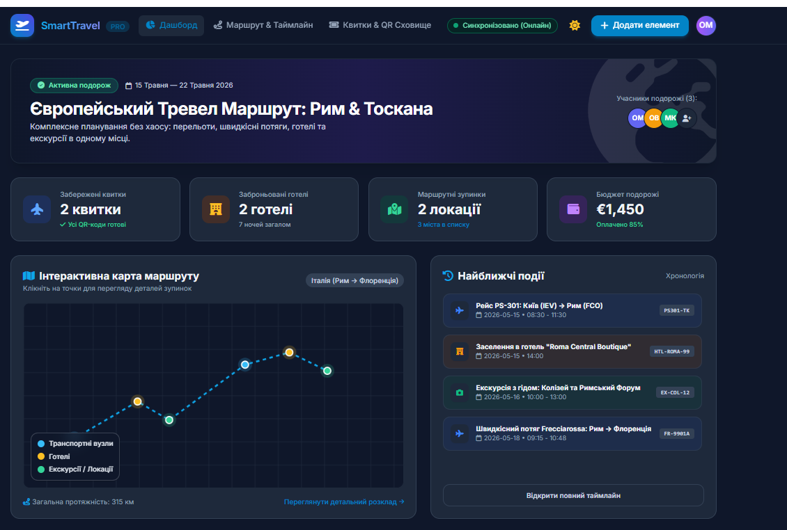
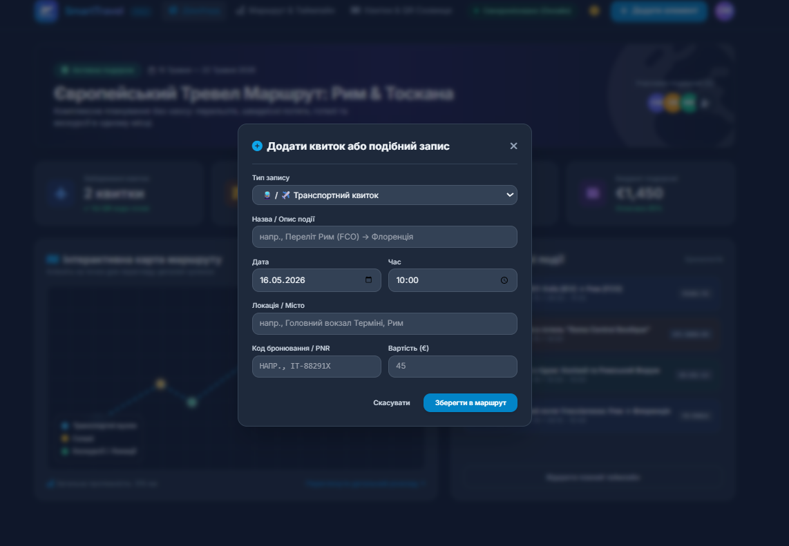

## Як почати роботу
**Реєстрація та вхід:**
Перейдіть на головну сторінку та натисніть кнопку "Зареєструватися".
Введіть електронну пошту, ім'я та пароль (або скористайтеся швидким входом через Google).
**Створення першої подорожі:**
На дашборді натисніть "+ Нова подорож".
Вкажіть назву (наприклад, "Канікули в Барселоні"), дати поездки та основне місто/країну.
**Формування маршруту:**
Відкрийте вкладку "Маршрут".
Додавайте місця, які плануєте відвідати, за днями та годинами.
**Керування бюджетом:**
Перейдіть у розділ "Бюджет".
Вкажіть загальний ліміт та додавайте витрати за категоріями (Житло, Транспорт, Їжа, Розваги).

